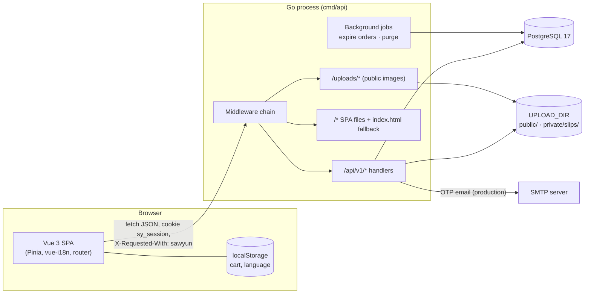
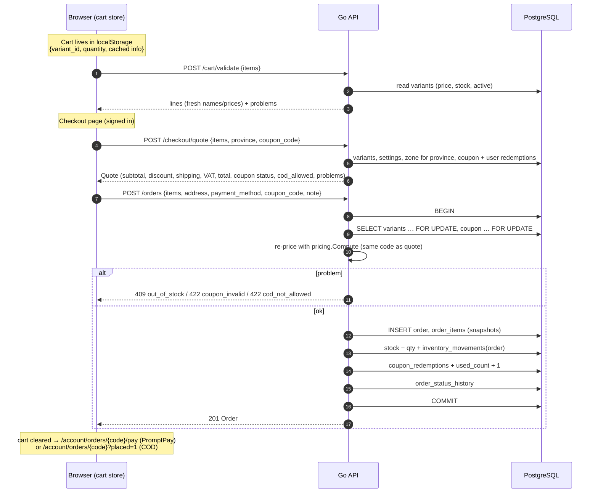

# Architecture

This document explains how the code is organised, how a request flows through it, and why the main
design decisions were made. Read [OVERVIEW.md](OVERVIEW.md) first for the business rules.

## 1. System diagram



In **production** there is one origin: the Go server serves the API, the uploaded images and the
built SPA. In **development** the Vite dev server (port 5173) serves the SPA and proxies `/api` and
`/uploads` to the Go server (port 8080), so the browser still sees one origin.

## 2. Backend

### 2.1 Start-up (`backend/cmd/api/main.go`)

1. Set `time.Local = UTC`; load config (`internal/config`).
2. Choose a text logger (development) or JSON logger (production), both to stdout.
3. Open the pgx pool (max 20 connections, session time zone UTC) and run embedded goose migrations.
4. `auth.EnsureAdmin` — make `ADMIN_EMAIL` an active admin.
5. Create `UPLOAD_DIR/public` and `UPLOAD_DIR/private/slips`.
6. Pick the mailer: `SMTPMailer` when production **and** `SMTP_HOST` is set, otherwise `LogMailer`.
7. Start background jobs, then `http.Server` with timeouts (read header 10 s, read/write 60 s, idle 120 s, max header 64 KB).
8. On Ctrl+C / SIGTERM: graceful shutdown with a 15-second deadline.

### 2.2 Packages (`backend/internal/*`)

| Package | Responsibility |
|---|---|
| `config` | Reads env vars and `.env` / `../.env`; defaults; refuses a weak `OTP_SECRET` in production. |
| `server` | Builds the router: every route, its middleware, `/uploads/` static files, SPA fallback, JSON 404 for unknown `/api/` paths. **Start here to find any endpoint.** |
| `middleware` | Recover, client IP, request logging, security headers, CORS (dev), per-IP and per-user rate limits, CSRF header check. |
| `httpx` | API error type and envelope, JSON encode/decode (1 MB limit), pagination, field validation helper, image upload (`SaveImage`). |
| `auth` | Email OTP (generate, HMAC-hash, verify), sessions (cookie `sy_session`), session list/revoke, `RequireAuth` / `RequireRole`, `EnsureAdmin`, mailers. |
| `catalog` | Public catalog (home, products, categories, events, reviews, wishlist) and admin catalog (products, variants, images, categories, events, review moderation). |
| `orders` | Cart validation, quote, placing orders, customer orders and cancel, PromptPay payload, slip upload, admin orders/status/tracking/slip review, dashboard, expiry. |
| `pricing` | **Pure functions** for subtotal, coupon validation, discount, shipping, VAT, total, COD. No database. |
| `promptpay` | Builds the EMVCo PromptPay QR payload (with amount) and CRC-16/CCITT-FALSE checksum. |
| `coupons` | Coupon lookup (with per-user redemption count) and admin CRUD. |
| `inventory` | `Move` (the only way stock changes, always with a movement row), admin stock list, adjustments, movement history, low-stock query. |
| `shipping` | Zones and their provinces, `ZoneFor(province)` with default-zone fallback, admin CRUD. |
| `geo` | The 77 Thai provinces (embedded `provinces.json`), `Canonical()` turns English (any case) or Thai names into the canonical English name. |
| `settings` | Key/value shop settings (JSONB) with typed load/save, public and admin views. |
| `users` | Profile update, address book, admin user list / grant role / enable-disable. |
| `audit` | `audit.Log` writes one row per admin change; admin list endpoint. |
| `ratelimit` | In-memory token-bucket limiter keyed by string, with periodic cleanup. |
| `jobs` | Background loops: expire unpaid orders every minute; purge old OTP codes and dead sessions every 30 minutes. |
| `db` | Pool setup, `Migrate`, `Tx` helper, `DBTX` interface (pool or transaction), unique/foreign-key error helpers, safe `LIKE` pattern. |

Handlers are methods on small structs (`catalog.Handler{DB, UploadDir}` etc.) with the signature
`func(w, r) error`. `httpx.H` turns a returned error into the JSON error envelope, so handlers just
`return httpx.Validation(...)`, `return httpx.NotFound()`, or return a database error (logged and
shown as `500 internal`; `pgx.ErrNoRows` becomes `404 not_found`).

### 2.3 Request lifecycle and middleware order

Global middleware is applied in this order (outermost first), in `server.New`:

```
Request
  │
  ├─ 1. Recover          panic → 500 {"error":{"code":"internal"}}
  ├─ 2. ClientIP         RemoteAddr, or first X-Forwarded-For entry when TRUST_PROXY=true
  ├─ 3. Logger           one log line: method, path, status, bytes, duration, ip, user_id
  ├─ 4. SecurityHeaders  CSP, nosniff, X-Frame-Options, Referrer-Policy, Permissions-Policy, HSTS*
  ├─ 5. CORS             development only, and only if CORS_ORIGIN is set
  ├─ 6. RateLimitIP      /api/* only: 300 requests / minute / IP
  ├─ 7. CSRF             /api/* non-GET/HEAD/OPTIONS: requires X-Requested-With: sawyun
  ├─ 8. auth.Middleware  reads sy_session cookie → loads user into context (or nothing)
  │
  └─ ServeMux route ── per-route middleware (in order given):
         RequireAuth | RequireRole("staff","admin") | RequireRole("admin")
         then RateLimitUser (orders 10/h, uploads 20/h) where used
         └─ handler
```

\* HSTS is sent only when `COOKIE_SECURE=true`.

Routing uses Go 1.22+ `ServeMux` patterns such as `GET /api/v1/products/{slug}`; handlers read
path values with `r.PathValue("slug")`. The full route table is in `server.go` and documented in
[API.md](API.md).

Because the session middleware runs for every request, `auth.UserFrom(ctx)` is available in any
handler; `RequireAuth` simply rejects requests where it is nil.

## 3. Frontend (`frontend/src`)

| Folder / file | What lives there |
|---|---|
| `main.ts` | Creates the app with Pinia, vue-i18n and the router; imports fonts (Inter, Noto Sans Myanmar) and global CSS. |
| `router/index.ts` | All routes. Store routes under `StoreLayout`, admin routes under `/admin` with `AdminLayout`. Route `meta`: `title` (i18n key), `requiresAuth`, `requiresStaff`, `requiresAdmin`, `guestOnly`, `keepScroll`. The global guard waits for `auth.init()` (one `/auth/me` call), redirects to `/login?redirect=…` when needed, and sets `document.title`. |
| `layouts/` | `StoreLayout` (header, footer, mobile tab bar) and `AdminLayout` (side navigation grouped as Sales / Catalog / Marketing / Administration). |
| `pages/store/` | Home, products, product detail, categories, events, cart, login, checkout, not found, and `account/` (profile, orders, order detail, pay, addresses, wishlist, security). |
| `pages/admin/` | One page per admin area (dashboard, orders, order detail, products, product edit, inventory, categories, events, coupons, reviews, shipping zones, settings, users, audit log). |
| `api/client.ts` | The only place that calls `fetch`. Prefixes `/api/v1`, sends `credentials: 'include'`, adds `X-Requested-With: sawyun` to non-GET requests, builds query strings, turns errors into `ApiError {code, status, fields, retryAfter}`, and notifies `onUnauthorized` listeners on 401. |
| `api/*.ts` | One module per area: `auth`, `catalog`, `account`, `orders` (checkout + my orders), `admin/index.ts` (all admin calls, only loaded by admin pages). |
| `types/api.ts` | TypeScript types that mirror [API.md](API.md). Keep them in sync with the Go structs. |
| `stores/` | Pinia: `auth` (current user, role helpers, OTP calls), `cart` (local cart + validation), `wishlist` (ids of saved products), `settings` (public shop settings), `ui` (toasts). |
| `i18n/` | `index.ts` sets up vue-i18n (Composition API mode, fallback `en`, locale saved as `sawyun-locale`). Messages are split: `en.json`/`my.json` (shared + storefront), `account.*.json` (checkout, address, account, orders, pay) loaded with the app, and `admin.*.json` **lazy-loaded** by `loadAdminMessages()` in the `/admin` route's `beforeEnter`, so customers never download admin text. |
| `composables/` | `useAsync` (loading/error state, latest call wins), `usePaged` (paged lists synced to `?page=`), `useForm` + `msg()` (zod validation with translated messages and API field errors), `useErrorMessage` (`ApiError.code` → `errors.<code>` translation), `useLocalized` (pick `_en`/`_my` fields, format dates), `useNow` (ticking clock for countdowns), `useFocusTrap` (modals/drawers), `usePageTitle`. |
| `components/ui/` | Generic building blocks: buttons, inputs, select, checkbox, modal, drawer, confirm dialog, tabs, pagination, badges, skeletons, file drop, rating stars, language switch, toasts. |
| `components/store/` | Shop pieces: header/footer, mobile tab bar, product card/grid/gallery/browser, hero carousel, event banner/countdown, reviews, wishlist button, OTP input, address form/card, order timeline, order summary. |
| `components/admin/` | Data table, page header, stat card, sales chart, image uploader, money input (baht ↔ satang), variant editor, product picker, province picker, `useAdminList`. |
| `utils/` | `money.ts` (satang ↔ baht, `฿1,290.00` formatting with `th-TH` locale), `localized.ts`, `date.ts`, `thaiAddress.ts` (lazy-loads `/data/thai-address.json` once), `misc.ts`. |
| `styles/` | `tokens.css` (colours, spacing, radius variables) and `global.css`. |

`vite.config.ts` splits large libraries into their own chunks (`vue-vendor`, `qrcode`, `zod`), and
every page is lazy-loaded by the router, so the first page load stays small on mobile data.

## 4. Data flow: cart → quote → order



Key points:

- The quote and the order use the **same function** (`buildQuote`), so the price the customer saw is the price they pay — unless prices or stock changed in between, in which case the order is re-priced or rejected.
- Placing an order is **one transaction** with row locks on the variants and coupon. Two customers buying the last item cannot both succeed; the second gets `409 out_of_stock`. A `CHECK (stock >= 0)` constraint is the final safety net.
- Order items store **snapshots** (names, SKU, image, unit price). Editing or deleting a product later does not change old orders.
- PromptPay: `GET /me/orders/{code}/promptpay` returns the EMVCo payload string; the browser turns it into a QR image with the `qrcode` library (loaded only on the pay page).

## 5. Background jobs (`internal/jobs`)

| Job | Interval | What it does |
|---|---|---|
| Expire orders | every 1 minute (also once at start) | Up to 100 `pending_payment` orders with `payment_due_at < now()` per run: restore stock, release coupon, set `expired`. Uses `FOR UPDATE SKIP LOCKED`, so it never blocks a customer who is uploading a slip at the same moment. |
| Purge | every 30 minutes (also once at start) | Delete OTP codes older than 1 day; delete sessions that are expired or idle longer than `SESSION_IDLE_HOURS`. |
| Rate-limit cleanup | every 5 minutes | Drops in-memory buckets that are full again. |

Jobs run as goroutines inside the API process and stop on shutdown. If you ever run **more than
one** API instance, the expiry job is still safe (row locks), but rate limits will be per instance.

## 6. File uploads

| Kind | Endpoint | Stored at | Served by |
|---|---|---|---|
| Product images | `POST /admin/products/{id}/images` | `UPLOAD_DIR/public/products/<random>.jpg` | `GET /uploads/products/…` (public, cached 1 year, immutable) |
| Category image | `POST /admin/categories/{id}/image` | `UPLOAD_DIR/public/categories/` | `GET /uploads/categories/…` |
| Event banner | `POST /admin/events/{id}/banner` | `UPLOAD_DIR/public/events/` | `GET /uploads/events/…` |
| Payment slips | `POST /me/orders/{code}/slip` | `UPLOAD_DIR/private/slips/` | **Only** `GET /api/v1/admin/slips/{id}/file` for staff, `Cache-Control: private, no-store` |

All uploads go through `httpx.SaveImage`: multipart field `file`, max 5 MB, type detected from the
file **content** (JPEG, PNG or WebP only — never trusting the file name), saved under a random
32-hex-character name. The `/uploads/` handler serves only `UPLOAD_DIR/public`, so slips can never
be reached by URL guessing. Replacing or deleting an image also deletes the old file.

## 7. Key design decisions and trade-offs

| Decision | Why | Trade-off |
|---|---|---|
| **Single Go binary serves API + SPA** | One container, one origin: no CORS in production, `SameSite=Lax` cookies just work, simple hosting. | Frontend and backend deploy together. |
| **Standard library router, no framework** | Go 1.22 `ServeMux` has method + path patterns; fewer dependencies for interns to learn. | A little more manual code (e.g. `whereBuilder` for filters). |
| **Hand-written SQL with pgx (no ORM)** | Queries are explicit and easy to review; locking (`FOR UPDATE`) is visible. | More SQL to maintain; changing a column means editing several queries. |
| **Embedded goose migrations run on start** | Deploying a new image upgrades the schema automatically. | A bad migration blocks start-up; always back up before upgrading. |
| **Money as integer satang** | No floating-point rounding errors. | Must convert at the UI edge (`utils/money.ts`). |
| **Pricing as a pure package** | Easy unit tests; the quote and the order share one code path. | — |
| **Email OTP instead of passwords** | No password storage, resets or leaks; customers already have email. | Depends on email delivery; codes in the log in development. |
| **Opaque session tokens in the DB (not JWT)** | Can list and revoke sessions instantly (sign out device, disable user). | One DB lookup per request (indexed by primary key). |
| **Header-based CSRF (`X-Requested-With`)** | Browsers cannot send custom headers cross-site without a CORS preflight, which we never approve in production. Simple and stateless. | API clients (Postman, scripts) must add the header. |
| **In-memory rate limits** | No Redis needed. | Reset on restart; not shared between instances. |
| **Stock reserved at order time** | Prevents overselling. | Unpaid orders hold stock until they expire (default 30 minutes). |
| **Manual slip verification** | No payment-gateway cost or contract. | Staff workload; payments are confirmed only during working hours. |
| **Local disk uploads** | Zero extra services. | Must back up the uploads volume; does not scale to many servers without shared storage. |
| **Cart in localStorage** | Works for guests, no DB writes while browsing. | Cart does not follow the user to another device. |
| **Lazy admin translations and pages** | Customers on mobile do not download admin code or text. | Slight delay the first time `/admin` opens. |
