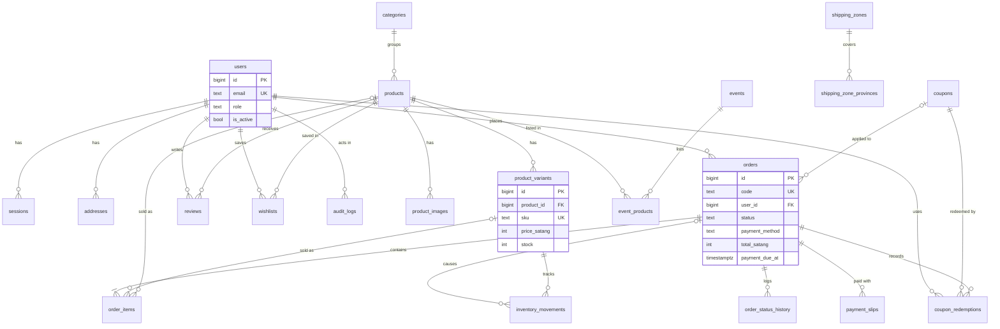

# Database

PostgreSQL 17. The whole schema is created by one migration,
`backend/internal/db/migrations/00001_init.sql`, which the API applies automatically on start.

## 1. Conventions

| Convention | Detail | Why |
|---|---|---|
| Money | Every amount is an **integer number of satang** in a column ending in `_satang` (1 THB = 100 satang, so ฿1,290.50 = `129050`). | Integers never have rounding errors. The UI converts with `frontend/src/utils/money.ts`. |
| VAT rate | `vat_rate_bp` in **basis points**: `700` = 7.00%. | Also an integer. |
| Time | `TIMESTAMPTZ`, stored and read in **UTC** (the pool sets `timezone=UTC`). Dashboard and order date filters convert to `Asia/Bangkok` in SQL. | One clear time zone in the database. |
| Bilingual text | Pairs of columns: `name_en` / `name_my`, `title_en` / `title_my`, `description_en` / `description_my`. English is required; Myanmar may be empty (the UI then falls back to English). | Simple to query, no translation table. |
| IDs | `BIGSERIAL` primary keys; public identifiers are separate (`orders.code` like `SY-7K2M9Q`, `slug` for products/categories/events). | Internal IDs never leak into customer URLs for orders. |
| Status / enum columns | `TEXT` with a `CHECK (… IN (…))` constraint. | Easy to read in SQL, easy to extend with a migration. |
| Provinces | Stored as the canonical **English** province name (`Bangkok`, `Chiang Mai`). The API accepts English in any case or Thai and converts it (`internal/geo`). | One key for addresses and shipping zones. |
| Snapshots | Orders copy the address, product names, SKU, image and unit price. | Old orders never change when products or addresses change. |

## 2. ER diagram



`otp_codes` and `settings` stand alone (no foreign keys).

## 3. Tables

### Accounts and authentication

**`users`** — every person who has signed in (customers, staff, admins).

| Column | Notes |
|---|---|
| `email` | Unique, must be lower case (`CHECK`). The login identity; cannot be changed in the UI. |
| `name`, `phone` | Optional profile fields (default `''`). |
| `role` | `customer` (default), `staff` or `admin`. |
| `is_active` | `false` = disabled: cannot sign in, sessions are deleted. |
| `created_at`, `updated_at` | |

**`otp_codes`** — one row per requested sign-in code.

| Column | Notes |
|---|---|
| `email` | Not a foreign key: codes exist before the user does. |
| `code_hash` | HMAC-SHA256 of `email|code` with `OTP_SECRET`. The code itself is never stored. |
| `attempts` | Wrong guesses so far (max 5). |
| `ip`, `expires_at` (created + 5 min), `consumed_at` (set when used or burned) | |

Index `(email, created_at DESC)` — verification always checks the newest code. Rows older than 1 day are purged.

**`sessions`** — signed-in browsers.

| Column | Notes |
|---|---|
| `id` | **SHA-256 of the cookie token**, never the token itself. The API shows only the first 16 characters as a public session id. |
| `user_id` | Cascade delete with the user. |
| `ip`, `user_agent` | Shown on the Security page. `ip` is refreshed with `last_seen_at`. |
| `last_seen_at` | Updated at most once a minute; used for the idle timeout. |
| `expires_at` | Absolute expiry (`SESSION_TTL_HOURS`). |

**`addresses`** — customer address book (max 20 per user, enforced in code).
`label`, `recipient_name`, `phone`, `line1`, `subdistrict`, `district`, `province` (canonical English), `postcode` (5 digits), `is_default` (exactly one default is kept by the code).

### Catalog

**`categories`** — `slug` (unique), `name_en`, `name_my`, `image_url`, `sort_order`, `is_active`. A category with any product cannot be deleted.

**`products`**

| Column | Notes |
|---|---|
| `slug` | Unique, used in the URL `/products/{slug}`. |
| `category_id` | Optional; `ON DELETE SET NULL`. |
| `name_*`, `description_*` | Bilingual. |
| `status` | `draft` (hidden), `active` (on sale), `archived` (hidden, kept for history). "Deleting" a product archives it. |
| `featured` | Shown in "Featured picks" on the home page. |
| `sold_count` | Increased when an order is marked delivered (seed sets demo values). Used for "popular" sorting. |
| `rating_avg` (`NUMERIC(3,2)`), `rating_count` | Recalculated from **approved** reviews on every moderation. |

**`product_images`** — `product_id`, `url` (e.g. `/uploads/products/abc….jpg`), `sort_order`. The lowest `sort_order` is the cover image.

**`product_variants`** — what is actually bought.

| Column | Notes |
|---|---|
| `sku` | Unique, stored upper case. |
| `name_en`, `name_my` | e.g. `Black / M`, `500 ml`. |
| `price_satang` | Price **excluding VAT**. The product card shows the cheapest active variant. |
| `compare_at_satang` | Optional "was" price shown struck through. |
| `stock` | `CHECK (stock >= 0)`. Changed only through `inventory.Move`. |
| `low_stock_threshold` | Default 5. At or below = "low stock". |
| `is_active`, `sort_order` | Inactive variants are hidden from customers. A variant with order history is deactivated instead of deleted. |

**`events`** — promotions: `slug`, `title_*`, `description_*`, `banner_url`, `starts_at`, `ends_at` (`CHECK ends_at > starts_at`), `is_active`, `sort_order`. "Running" = active and `starts_at ≤ now < ends_at`.

**`event_products`** — many-to-many between events and products, with `sort_order`. Primary key `(event_id, product_id)`.

### Shipping

**`shipping_zones`** — `name_*`, `fee_satang`, `free_over_satang` (NULL = never free), `is_default`, `sort_order`. A partial unique index allows **only one** default zone. The default zone is used for provinces not assigned anywhere.

**`shipping_zone_provinces`** — `(zone_id, province)`; `province` is **unique**, so a province belongs to at most one zone.

### Coupons

**`coupons`**

| Column | Notes |
|---|---|
| `code` | Unique, upper case, 3–32 of `A-Z 0-9 _ -`. |
| `type`, `value` | `percent` (1–100) or `fixed` (satang). |
| `min_order_satang` | Subtotal needed (default 0). |
| `max_discount_satang` | Optional cap for percent coupons. |
| `starts_at`, `ends_at` | Optional window (end is exclusive). |
| `usage_limit` | Total uses; NULL = unlimited. |
| `per_user_limit` | Uses per customer; default 1; `0` = unlimited. |
| `used_count` | Increased on order, decreased when the order is cancelled or expires. |
| `is_active` | A used coupon is deactivated instead of deleted. |

**`coupon_redemptions`** — `(coupon_id, order_id)` primary key plus `user_id`. Counted for the per-user limit; deleted when the order is cancelled/expired.

### Orders and payments

**`orders`**

| Column group | Columns |
|---|---|
| Identity | `code` (unique, `SY-` + 6 characters without look-alikes such as 0/O/1/I/L), `user_id`, `email` (copied from the user) |
| State | `status` (9 values, see [OVERVIEW.md](OVERVIEW.md#5-order-lifecycle)), `payment_method` (`promptpay` / `cod`) |
| Money (snapshot) | `subtotal_satang`, `discount_satang`, `shipping_satang`, `vat_rate_bp`, `vat_satang`, `total_satang` |
| Coupon | `coupon_id` (SET NULL on delete), `coupon_code` (text copy) |
| Address (snapshot) | `recipient_name`, `phone`, `line1`, `subdistrict`, `district`, `province`, `postcode` |
| Extra | `note` (customer, ≤ 500 chars), `courier`, `tracking_number`, `tracking_url` |
| Timeline | `payment_due_at`, `paid_at`, `shipped_at`, `delivered_at`, `cancelled_at`, `cancel_reason`, `created_at`, `updated_at` |

Indexes: `(user_id, created_at DESC)` for "my orders", `(status, created_at DESC)` for admin filters, and a partial index on `payment_due_at WHERE status = 'pending_payment'` for the expiry job.

**`order_items`** — snapshot lines: `product_id` / `variant_id` (both SET NULL if deleted), `product_name_*`, `variant_name_*`, `sku`, `image_url`, `unit_price_satang`, `quantity > 0`. Line totals are computed, not stored.

**`order_status_history`** — `order_id`, `status`, `note`, `user_id` (who; NULL for the system job), `created_at`. The customer's timeline.

**`payment_slips`** — `order_id`, `file_path` (relative to `UPLOAD_DIR/private`, e.g. `slips/ab12….png`), `status` (`pending` / `approved` / `rejected`), `note` (reason shown to the customer), `reviewed_by`, `reviewed_at`, `uploaded_at`.

### Inventory, reviews, wishlist

**`inventory_movements`** — the stock ledger. `variant_id`, `change` (+/−), `reason` (`order`, `cancel`, `expire`, `restock`, `adjust`, `damage`), `note`, `order_id`, `user_id`, `stock_after`, `created_at`. Every stock change writes exactly one row, so the history always explains the current number.

**`reviews`** — `product_id`, `user_id`, `order_id` (the delivered order that allowed it), `rating` 1–5, `comment`, `status` (`pending` / `approved` / `rejected`). `UNIQUE (product_id, user_id)`.

**`wishlists`** — `(user_id, product_id)` primary key, `created_at`.

### Settings and audit

**`settings`** — key/value with `JSONB` values. Seeded keys:

| Key | Default | Meaning |
|---|---|---|
| `shop_name` | `"Sawyun Ecommerce"` | |
| `promptpay_id` | `""` | Mobile number or 13-digit tax ID (also accepts 15-digit e-wallet ID). Empty = PromptPay cannot be paid. |
| `promptpay_name` | `""` | Account name shown under the QR. |
| `vat_rate_bp` | `700` | 7%. |
| `payment_window_minutes` | `30` | PromptPay deadline (5–10080). |
| `cod_max_satang` | `1000000` | ฿10,000. |
| `support_email`, `support_phone` | `""` | Shown to customers. |

**`audit_logs`** — `user_id`, `action` (e.g. `order.status`, `slip.approve`, `product.update`, `settings.update`), `entity`, `entity_id` (text), `details` (JSONB), `ip`, `created_at`. Written in the **same transaction** as the change it records.

## 4. Migrations

Migrations use [goose](https://github.com/pressly/goose). The `.sql` files are embedded into the Go
binary (`//go:embed migrations/*.sql` in `internal/db/db.go`) and `db.Migrate` applies every pending
"Up" migration when the API or the seed starts. goose records applied versions in its own table
`goose_db_version`.

### Adding a migration

1. Create the next numbered file in `backend/internal/db/migrations/`, e.g. `00002_add_order_weight.sql`:

   ```sql
   -- +goose Up
   ALTER TABLE orders ADD COLUMN weight_grams INT NOT NULL DEFAULT 0;

   -- +goose Down
   ALTER TABLE orders DROP COLUMN weight_grams;
   ```

   Use `-- +goose StatementBegin` / `-- +goose StatementEnd` around anything containing semicolons inside one statement (functions, `DO` blocks).
2. Restart the API (`go run ./cmd/api`). The log shows `migrations applied`.
3. Update the Go structs and SQL that use the table, `docs/API.md` if the JSON changes, `frontend/src/types/api.ts`, and this document.
4. Test on a copy of real data when the migration changes existing rows.

Rules:

- **Never edit a migration that has been deployed** (including `00001_init.sql`). Always add a new file.
- Keep numbers sequential (`00002`, `00003`…). If two branches both add `00002`, the second to merge renames theirs.
- Make "Up" safe for existing data: add columns with a `DEFAULT`, or add them nullable, backfill, then add `NOT NULL` in a later migration.
- There is no automatic "Down" on deploy. To roll back in production, restore the backup taken before the upgrade (see [DEPLOYMENT.md](DEPLOYMENT.md#8-upgrading)). Locally you can reset everything with `docker compose down -v` (this **deletes** the database volume).

Optional: the goose CLI can create files and inspect state, e.g.
`go run github.com/pressly/goose/v3/cmd/goose@v3.29.0 -dir internal/db/migrations -s create add_order_weight sql`
(`-s` gives sequential numbers instead of timestamps).

## 5. Seed data

`go run ./cmd/seed` (from `backend/`) runs the migrations, ensures the `ADMIN_EMAIL` admin, then
inserts demo data in one transaction. It is idempotent (`ON CONFLICT` everywhere).

| Data | Content |
|---|---|
| Categories (6) | Fashion, Shoes, Electronics, Home & Living, Beauty, Food & Snacks — with Myanmar names. |
| Products (16) | All `active`, each with 1–4 variants, prices from ฿120 to ฿2,490, some with compare-at prices, staggered `created_at` and demo `sold_count`. Stock is set only when a variant is first created (with a `restock` movement, note `seed`); re-running does not reset stock. One variant (Smart Fitness Watch – Pink) has 0 stock and one (T-shirt Black / L) is low. No images. |
| Events (2) | **11.11 Sale** — started 2 days before the seed run, ends 12 days after, 6 products. **12.12 Year-End Sale** — starts 20 days after the seed run, 3 products. Dates are reset on every run. |
| Shipping zones (3) | **Bangkok & Vicinity** (Bangkok, Nonthaburi, Pathum Thani, Samut Prakan, Samut Sakhon, Nakhon Pathom): ฿40, free from ฿1,000. **Central & East** (20 provinces): ฿60, free from ฿1,500. **North / Northeast / South** — the **default** zone for every other province: ฿80, free from ฿2,000. |
| Coupons (2) | `WELCOME10`: 10%, min ฿300, max discount ฿200, 1 per customer. `SAVE50`: ฿50 fixed, min ฿500, 3 per customer. |
| Settings | Only if still empty: PromptPay ID `0812345678`, name "Sawyun Shop", `support@example.com`, `02-123-4567`. |

The seed creates no customers and no orders; sign in and place orders to create them.
