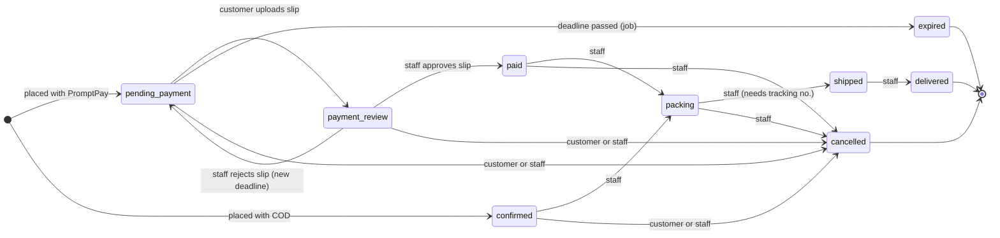

# Product overview and scope

This document explains **what** Sawyun Ecommerce does and **which rules** it follows. It is written
for the whole team and for the internship supervisor. For how the code is built, see
[ARCHITECTURE.md](ARCHITECTURE.md); for every endpoint, see [API.md](API.md).

## 1. The problem it solves

The business sells everyday goods (fashion, shoes, electronics, home items, beauty, snacks) to
customers living in Thailand, many of whom read Myanmar more comfortably than English or Thai.
Before this project, orders came through chat apps and payments were checked by hand with no shared
record. The goals were:

1. Let customers order on their phone in **English or Myanmar**.
2. Support the two payment methods customers already use: **PromptPay** bank transfer and **cash on delivery (COD)**.
3. Give staff **one place** to verify payments, pack and ship orders, and keep stock correct.
4. Keep the system **small and cheap to run**: one server process plus PostgreSQL.

## 2. Customer features

| Area | What the customer can do | Notes |
|---|---|---|
| Language | Switch between English and Myanmar from the header. | The choice is remembered in the browser (`localStorage` key `sawyun-locale`). Product names and descriptions have both languages; if the Myanmar text is empty, English is shown. |
| Home | See running events with a countdown, categories, "Popular right now" (by units sold), "Featured picks" and "New arrivals" (8 each). | Only events that are active **and** inside their start/end time are shown. |
| Browse | List all products; search by text; filter by category, price range and "in stock only"; sort by popular, newest, price, rating. | Search matches the English name, the Myanmar name and the English description. Only `active` products are visible. |
| Product page | Image gallery, choose a variant (e.g. "Black / M"), quantity, add to cart or buy now, see approved reviews, save to wishlist. | Price shown is the variant price; a struck-through "compare-at" price shows a discount badge. |
| Cart | Add, change quantity (max 99 per line), remove. | Stored in the browser, so it works before signing in. Every time the cart is opened it is re-checked with the server for current prices and stock. |
| Sign in | Enter email → receive a 6-digit code → enter the code. | No passwords. A new email automatically becomes a customer account. |
| Checkout | Pick a saved address or type a new one, apply a coupon, choose PromptPay or COD, add a note, place the order. | Shipping, VAT and the total are calculated by the server (the "quote") and shown live. |
| Pay (PromptPay) | Scan the QR with any Thai banking app, pay, upload a slip photo. | The QR already contains the exact amount. A countdown shows the payment deadline. |
| Orders | List and filter own orders, open an order to see the timeline, items, address, payment slips, tracking. | Cancel while the order is still `pending_payment`, `payment_review` or `confirmed`. |
| Reviews | Rate 1–5 stars and comment on a product **after** an order with that product is delivered. | One review per product per customer; it appears after staff approve it. |
| Account | Profile (name, phone), address book (up to 20, one default), wishlist, security (signed-in devices). | Sign out one device or all other devices. |

## 3. Admin features

The admin area lives under `/admin`. **Staff** can use most of it; some pages are **admin only**
(marked ★). A step-by-step guide per page is in [ADMIN_GUIDE.md](ADMIN_GUIDE.md).

| Page | Purpose |
|---|---|
| Dashboard | Today's sales and order count, slips to review, orders to pack, low-stock count, 7-day sales chart, 10 recent orders, 10 lowest-stock items. |
| Orders | Search and filter orders; open one to approve/reject payment slips, move it through packing → shipped → delivered, cancel it, and enter courier tracking. |
| Products | Create/edit products with English and Myanmar text, category, status (draft / active / archived), "featured" flag, events, images (upload, reorder, delete) and variants (SKU, price, compare-at price, low-stock threshold). |
| Inventory | See stock per variant (low stock first), adjust stock with a reason (restock, correction, damaged/lost), see every stock movement. |
| Categories | Create/edit/delete categories with an image and sort order. |
| Events | Promotions such as "11.11 Sale" with a banner, start/end time and a list of products. |
| Coupons | Percent or fixed-amount coupons with minimum order, maximum discount, date range, total and per-customer limits. |
| Reviews | Approve or reject customer reviews; product ratings are recalculated from approved reviews. |
| ★ Shipping zones | Group the 77 provinces into zones with a fee and an optional free-delivery threshold; one zone is the default. |
| ★ Settings | Shop name, PromptPay ID and account name, VAT rate, payment window, COD limit, support email/phone. |
| ★ Users & staff | Find users, add staff/admins by email, change roles, disable accounts. |
| ★ Audit log | Read-only list of every admin change: who, what, when, from which IP. |

## 4. Roles and permissions

There are three roles, stored in `users.role`. The backend enforces them on every request (the
frontend only hides menu items).

| Action | Visitor | Customer | Staff | Admin |
|---|:-:|:-:|:-:|:-:|
| Browse products, events, categories; use the cart | ✓ | ✓ | ✓ | ✓ |
| Sign in with email OTP | ✓ | – | – | – |
| Checkout, own orders, pay, cancel own order | – | ✓ | ✓ | ✓ |
| Wishlist, addresses, profile, sessions, write reviews | – | ✓ | ✓ | ✓ |
| Dashboard, orders, slips, tracking | – | – | ✓ | ✓ |
| Products, variants, images, inventory, categories, events | – | – | ✓ | ✓ |
| Coupons, review moderation | – | – | ✓ | ✓ |
| Shipping zones, settings | – | – | – | ✓ |
| Users & roles, audit log | – | – | – | ✓ |

Rules worth knowing:

- The email in `ADMIN_EMAIL` is made an active admin every time the API starts, so the shop can never lock itself out.
- An admin cannot change their own role or disable their own account.
- Disabling an account signs that user out on every device immediately.
- Staff and admins can also shop as customers with the same account.

## 5. Order lifecycle

An order has one of nine statuses. Where it starts depends on the payment method.

What happens at each step:

| Event | Effect |
|---|---|
| Order placed | Stock is reduced immediately (reason `order`), the coupon use is recorded, prices are copied into the order. PromptPay orders get `payment_due_at = now + payment window` (default 30 minutes). |
| Slip uploaded | Allowed only while `pending_payment`. The order moves to `payment_review` and waits for staff. |
| Slip approved | Order becomes `paid`, `paid_at` is set. |
| Slip rejected | Staff must write a reason (the customer sees it). Order goes back to `pending_payment` with a **new** deadline, so the customer can upload again. |
| Deadline passed | Every minute a background job moves overdue `pending_payment` orders to `expired`. |
| Cancelled or expired | Stock is put back (reason `cancel` / `expire`), the coupon use is released, any pending slip is marked rejected. |
| Shipped | Requires a tracking number first; `shipped_at` is set. |
| Delivered | `delivered_at` is set, product `sold_count` goes up, and the customer may now review the products. |

Every change writes a row in `order_status_history`, which the customer sees as the timeline, and
every staff change is also written to the audit log.

**Why stock is reserved at order time:** if we waited until payment, two customers could pay for
the last item. Reserving early and releasing on cancel/expiry keeps stock honest; the short payment
window stops unpaid orders from holding stock for long.

## 6. Pricing rules

The **backend is the only place that calculates money** (`backend/internal/pricing`). The browser
shows the server's quote and never sends prices, so a modified browser cannot change what an
order costs. All amounts are whole numbers of **satang** (1 baht = 100 satang) to avoid rounding
errors with decimals.

1. **Subtotal** = sum of (current variant price × quantity).
2. **Discount** (if a valid coupon):
   - percent: `subtotal × percent ÷ 100`, rounded down, then capped by the coupon's maximum discount;
   - fixed: the coupon value, but never more than the subtotal.
3. **Shipping** = the fee of the zone that contains the delivery province (or the default zone). It becomes **0** when the zone has a free-delivery threshold and `subtotal − discount` reaches it. With no province or no matching zone, shipping is 0.
4. **VAT** = `(subtotal − discount + shipping) × VAT rate`, rounded half up to the nearest satang. The default rate is 7% (stored as `700` basis points). Product prices are entered **without** VAT; VAT is added at checkout.
5. **Total** = `subtotal − discount + shipping + VAT`.
6. **COD** is offered only if the total is at most the COD limit (default ฿10,000).

A coupon is valid only if it exists, is active, has started, has not ended, has uses left in total
and for this customer, and the subtotal reaches its minimum order. Otherwise the quote returns a
message code such as `coupon_min_order` and the order is priced without the coupon.

### Worked example

A customer in **Bangkok** buys one **Smart Fitness Watch (Black)** at ฿2,490.00 with coupon
**WELCOME10** (10% off, minimum ฿300, maximum discount ฿200). Bangkok is in the seeded "Bangkok &
Vicinity" zone: fee ฿40, free delivery from ฿1,000.

| Step | Calculation (satang) | Amount |
|---|---|---|
| Subtotal | 249,000 × 1 | ฿2,490.00 |
| Discount | 10% of 249,000 = 24,900 → capped at 20,000 | −฿200.00 |
| After discount | 249,000 − 20,000 = 229,000 | ฿2,290.00 |
| Shipping | 229,000 ≥ 100,000 → free | ฿0.00 |
| VAT 7% | (229,000 × 700 + 5,000) ÷ 10,000 = 16,030 (integer division) | ฿160.30 |
| **Total** | 229,000 + 0 + 16,030 | **฿2,450.30** |

The total is below ฿10,000, so COD is also allowed. The pricing rules are unit-tested in
`backend/internal/pricing/pricing_test.go` (`TestCompute`, `TestValidateCoupon`); if you change a
rule, add a test case there first (this worked example is a good one to add).

## 7. Intentionally out of scope

These were left out on purpose for the first version. Each is a good next step (see the backlog in
[DEVELOPMENT.md](DEVELOPMENT.md#8-suggested-backlog)).

| Not included | Why | What we do instead |
|---|---|---|
| Automatic PromptPay payment verification | Needs a paid bank or payment-gateway API, a business bank account contract, and webhook handling. Too much cost and paperwork for an internship MVP. | The customer uploads a slip; staff compare it with the bank app and approve or reject. |
| Courier APIs (Kerry, Flash, Thailand Post…) | Each courier has a different API and contract; label printing was not required. | Staff type the courier name, tracking number and (optional) tracking link. |
| Cloud file storage (S3 etc.) | Adds an external service and cost; the expected number of images is small. | Files are stored on disk in `UPLOAD_DIR` (a Docker volume in production) and must be backed up with the database. |
| Order emails (confirmation, shipped…) | Needs reliable mail delivery, templates in two languages, and a retry queue. | Customers check the order page. Only the sign-in code is emailed. |
| Online card payments, refunds, partial shipments, multi-currency, Thai-language UI | Not requested by the business for launch. | Refunds for cancelled paid orders are handled outside the system. |
